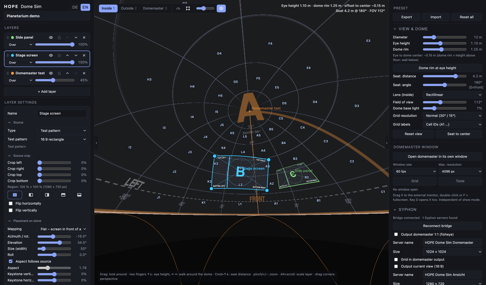
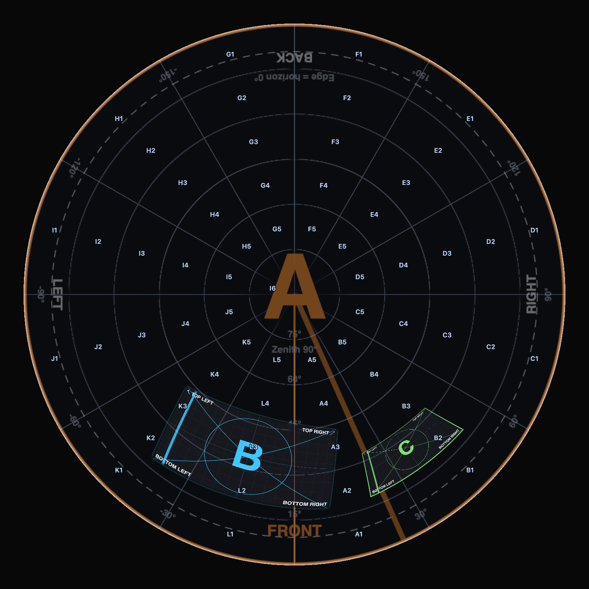

# HOPE Dome Sim

**A browser-based dome projection simulator** – preview 2D content, panoramas and pre-rendered fulldome material on a dome, check it from any seat, and send the result on as a domemaster via Syphon.

Created by **Sonarkon** · <https://github.com/sonarkon/Dome-Sim>

*Deutsche Kurzfassung weiter unten.*



*Inside view from a seat: layers with corner handles, grid with cell IDs (A1 …), view & dome settings, domemaster window and Syphon options.*

<p align="center">
  
</p>

*The separate domemaster window (1:1 fisheye, front at the bottom) with grid, cell IDs and tools switched on – ready to drag to an external monitor and go fullscreen.*

---

## What it does

- **Three views:** inside (from a seat, rectilinear or fisheye), outside (cut-away) and the flat **domemaster** (1:1 fisheye).
- **Up to 8 layers** with order (drag & drop), lock, visibility, opacity and blend modes (over / add / subtract / multiply / screen).
- **Placement:** flat screen, quad in domemaster plane, quad in azimuth/elevation, 360° panorama band, full domemaster. Corner-pin warp, keystone, per-side edge feather with falloff curve, source crop, flips.
- **Edge extension** for videos on a solid background (stretch edge pixels or fill with the median edge color).
- **Grid overlay** with adjustable resolution (45°/30° down to 10°/5°) and optional labels: cell IDs (A1 …) or az/el coordinates. Toggle and strength sit in the toolbar; the grid can also be shown in the domemaster window and the domemaster Syphon output.
- **Audience position:** eye height, dome rim height (springline offset), seat distance/angle, draggable seat in the outside view.
- **Sources:** Syphon (via the bridge, macOS), camera / virtual cam, window / screen capture, video files (loop, play/pause, scrub timeline) and still images, built-in test patterns (16:9, 2:1 equirect, 1:1 domemaster).
- **Projects & presets:** project name field above the layers; presets export as JSON named after the project.
- **Outputs:** Syphon servers for the domemaster and/or the current view, plus a separate **domemaster window** for an external monitor.
- **Show mode:** throttles only the local preview so outputs get more GPU.
- English and German UI (English by default; switch in the top left).

Domemaster orientation follows the [IMERSA guidelines](https://imersa.org/guidelines): zenith in the center, horizon on the edge, **front at the bottom**, left/right as seen from the dome center.

## Requirements

| Part | Platform |
|---|---|
| **Simulator** (`index.html`) | Any current browser with WebGL2 (Chrome, Edge, Safari, Firefox) on **macOS, Windows and Linux**. |
| **Syphon bridge** (`bridge/`) | **macOS only** (Syphon exists only there). Needs the Xcode Command Line Tools and a `Syphon.framework`. |

Without the bridge everything except Syphon in/out works on every platform: camera / virtual cam (e.g. OBS Virtual Camera, also useful with Spout on Windows), window / screen capture, video files and the domemaster window.

## Quick start

```bash
git clone https://github.com/sonarkon/Dome-Sim.git
cd Dome-Sim
```

Then start it with one double-click (or from the terminal):

| System | Start | What happens |
|---|---|---|
| **macOS** | `start.command` | Builds and runs the Syphon bridge and opens <http://localhost:8766>. Without the Xcode Command Line Tools it falls back to the plain server below. |
| **Windows** | `start.bat` | Plain local server, opens <http://localhost:8765/index.html> (needs Python 3). |
| **Linux / macOS without Syphon** | `./start.sh` | Plain local server, opens <http://localhost:8765/index.html> (needs Python 3). |

You can also open `index.html` directly in Chrome; a local server is more robust (e.g. for Safari and camera permissions).

### Syphon (macOS only)

1. Run `start.command` (first run builds the bridge; needs the Xcode Command Line Tools: `xcode-select --install`).
2. The bridge needs a **`Syphon.framework`**. It looks next to the binary (`bridge/Syphon.framework`), in `/Library/Frameworks`, in `$SYPHON_FRAMEWORK`, and inside installed apps (Millumin, Resolume, VDMX …). If you have none of those, download the framework from the [Syphon releases](https://github.com/Syphon/Syphon-Framework/releases) and drop `Syphon.framework` into `bridge/`.
3. In the app choose *Syphon (via bridge)* for a layer and pick the server; enable *Syphon output* to publish the domemaster.

Nothing from Syphon is redistributed here. The bridge listens on `127.0.0.1` only.

> **Downloaded the ZIP instead of cloning?** macOS may block the double-click (“unidentified developer”). Run once: `xattr -dr com.apple.quarantine .` in the project folder, or right-click → Open.

## Controls (short)

| Action | Gesture |
|---|---|
| Look around / orbit | drag |
| Eye height / walk around the dome (inside view) | two-finger scroll ↑↓ / ←→ |
| Seat distance | Cmd + two-finger scroll (macOS) or the slider |
| Zoom | pinch, `+` / `−` |
| Move layer / warp corners | drag surface / drag corner handles |
| Scale layer | Alt + scroll |
| Views | `1` `2` `3` |
| Show/hide frames | `R` |
| Show/hide grid | `G` |
| Columns | `[` `]` `H` |
| Show mode | `S` |
| Domemaster window | `D` (double-click or `F` in it for fullscreen) |

## Credits & licenses

- **HOPE Dome Sim** – © 2026 Sonarkon · <https://github.com/sonarkon/Dome-Sim> · [MIT License](LICENSE)
- **Syphon** – © the Syphon contributors, BSD 2-clause. <https://github.com/Syphon/Syphon-Framework> · <https://syphon.github.io/>
- Domemaster conventions: [IMERSA guidelines](https://imersa.org/guidelines).

---

## Kurzfassung (Deutsch)

**HOPE Dome Sim** ist ein Kuppelprojektions-Simulator im Browser von **Sonarkon**: 2D-Inhalte, Panoramen und vorgerendertes Fulldome-Material auf der Kuppel ansehen, von jedem Sitzplatz prüfen und den Domemaster per Syphon weitergeben.

- Der **Simulator** läuft in jedem aktuellen Browser auf **macOS, Windows und Linux**.
- Die **Syphon-Brücke** (`bridge/`) gibt es nur für **macOS**. Ohne Brücke funktionieren Kamera/Virtual Cam, Fenster-Aufnahme, Videodatei und das Domemaster-Fenster überall.
- Start mit Syphon: `./bridge/start.command`, ohne Syphon: `python3 -m http.server 8765`.
- Die Oberfläche ist zweisprachig (Standard Englisch, DE/EN-Umschalter oben links).
